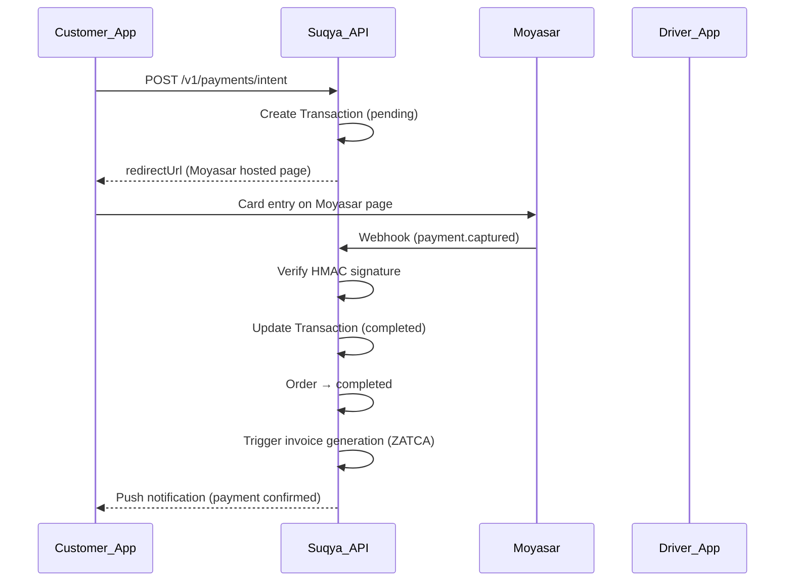

# ADR-003: Moyasar Payment Gateway

**Status**: Accepted  
**Date**: 2026-02-01  
**Phase**: 14 · Sprint 11  
**Decision Makers**: Engineering Lead, Finance, CTO

## Context

Suqya needs a payment gateway to process card payments in Saudi Riyals (SAR) for water tanker orders. Requirements:

- SAR currency support with local card networks (mada)
- Saudi-based provider (regulatory alignment)
- Support for B2C (simplified invoices) and B2B (standard invoices) payment flows
- Webhook-based payment confirmation
- PCI DSS compliance without storing card data on our servers
- Split payment support (partial card + cash on delivery)
- Settlement reporting for supplier payouts
- Reasonable transaction fees for marketplace model (2–3% commission margin)

## Decision

Integrate **Moyasar** as the primary payment gateway, with **cash on delivery** as a fallback payment method.

## Implementation

Payment logic in `apps/api/src/modules/payment/payment.service.ts`:

### Payment flow



### Configuration

| Variable | Purpose |
|----------|---------|
| `MOYASAR_PUBLISHABLE_KEY` | Client-side key (`pk_test_*` / `pk_live_*`) |
| `MOYASAR_SECRET_KEY` | Server-side key (`sk_test_*` / `sk_live_*`) |
| `PAYMENT_CALLBACK_URL` | Redirect after card payment |

Defined in `apps/api/.env.example`.

### Payment methods

| Method | Flow | Module Logic |
|--------|------|-------------|
| `card` | Moyasar hosted page → webhook | `createIntent()` → `capture()` |
| `cash` | Driver collects on delivery | `createIntent()` status `pending` → driver confirms |
| `credit` | Deduct from credit account | `credit` module, no gateway |
| `wallet` | Deduct from wallet balance | `wallet` module, no gateway |
| `split` | Card + cash combination | `createSplitPayment()` |

### Webhook security

Moyasar webhooks verified via HMAC-SHA256 in `payment.service.ts`:

```typescript
// Simplified — see payment.service.ts for full implementation
const signature = createHmac('sha256', secretKey)
  .update(rawBody)
  .digest('hex');
timingSafeEqual(signature, requestSignature);
```

## Rationale

### Why Moyasar over alternatives

| Gateway | SAR/mada | Saudi Entity | API Quality | Fees | PCI Scope | Verdict |
|---------|----------|-------------|-------------|------|-----------|---------|
| **Moyasar** | ✅ | ✅ Riyadh | ✅ REST + webhooks | 2.9% + SAR 1 | SAQ A (redirect) | ✅ Selected |
| HyperPay | ✅ | ✅ | ✅ Enterprise | 2.5% + negotiable | SAQ A | ❌ Enterprise pricing |
| Tap Payments | ✅ | ✅ | ✅ | 2.75% + SAR 1 | SAQ A | ❌ Less local focus |
| Stripe | ❌ No mada | ❌ US entity | ✅ Excellent | N/A in SA | N/A | ❌ |
| PayTabs | ✅ | ✅ | ⚠️ Legacy API | 2.85% | SAQ A | ❌ API ergonomics |
| Apple Pay / STC Pay | ✅ | ✅ | Via aggregator | Varies | N/A | 🔜 Phase 15 |

### Key decision factors

1. **mada support**: 70%+ of Saudi card transactions use mada. Moyasar natively supports mada alongside Visa/Mastercard.

2. **Saudi entity**: Moyasar is headquartered in Riyadh. Simplifies regulatory compliance and SAR settlement.

3. **Hosted payment page**: Redirect model keeps Suqya at PCI SAQ A level — no card data touches our servers. Critical for a startup without PCI certification.

4. **Developer experience**: REST API with clear documentation, sandbox environment, webhook support. Implementation in `payment.service.ts` is ~170 lines.

5. **Marketplace support**: Moyasar supports split settlements (platform commission + supplier payout) needed for marketplace mode.

6. **ZATCA alignment**: Moyasar provides transaction receipts compatible with ZATCA simplified invoice requirements.

## Consequences

### Positive

- No PCI DSS certification required (SAQ A — redirect model)
- mada + Visa + Mastercard in single integration
- Sandbox for development and staging (`pk_test_*` keys)
- Webhook-driven payment confirmation is reliable
- SAR settlement to Saudi bank account
- Transaction metadata links to Suqya `orderId` for reconciliation

### Negative

- Vendor lock-in to Moyasar API (mitigated: payment interface abstracted in service layer)
- 2.9% + SAR 1 per transaction reduces marketplace margin
- Moyasar downtime blocks card payments (mitigated: cash fallback via feature flag)
- No native Apple Pay / STC Pay yet (planned via Moyasar in Phase 15)
- Refund API limited to full refunds (partial refunds require support ticket)

### Financial impact

| Metric | Value |
|--------|-------|
| Moyasar fee | 2.9% + SAR 1 per transaction |
| Avg order value | SAR 350 (18,000L tanker) |
| Fee per order | ~SAR 11.15 |
| Platform commission (12%) | SAR 42 |
| Net margin per card order | ~SAR 30.85 |

Cash orders avoid gateway fees entirely — incentivizes cash for price-sensitive customers.

## Risk Mitigation

| Risk | Mitigation |
|------|------------|
| Moyasar outage | Feature flag `payments.cash_only=true`; queue retries |
| Webhook missed | Reconciliation job compares Moyasar settlements vs. local transactions daily |
| Double capture | Idempotent `capture()` — checks transaction status before update |
| Amount tampering | Server-side amount from `Order.totalAmount`; never trust client |
| Key compromise | Rotate via Moyasar dashboard + K8s secret update |

## Alternatives Considered

### HyperPay
Strong enterprise option used by large Saudi retailers. Rejected for MVP due to enterprise sales cycle, minimum volume commitments, and more complex integration. May revisit for Phase 16 if volume exceeds 50k transactions/month.

### Direct bank integration (SADAD)
Government payment system. Not suitable for real-time mobile payments — batch settlement, no webhook support.

### Build custom payment processing
Rejected: PCI DSS Level 1 certification costs SAR 500k+ and 12+ months. Not viable for startup.

## Future Considerations

| Feature | Timeline | Notes |
|---------|----------|-------|
| Apple Pay via Moyasar | Phase 15 | Moyasar supports Apple Pay SDK |
| STC Pay | Phase 15 | Popular Saudi digital wallet |
| Recurring billing (SaaS mode) | Phase 15 | For private-label tenant subscriptions |
| Multi-gateway failover | Phase 16 | HyperPay as backup gateway |
| International cards (GCC) | Phase 16 | GCC expansion |

## References

- [Payment Service](../../apps/api/src/modules/payment/payment.service.ts)
- [Security Policy](../security/security-policy.md)
- [Compliance Matrix](../business/compliance-matrix.md)
- [ADR-001: Modular Monolith](001-modular-monolith.md)
- Moyasar API documentation: https://docs.moyasar.com
