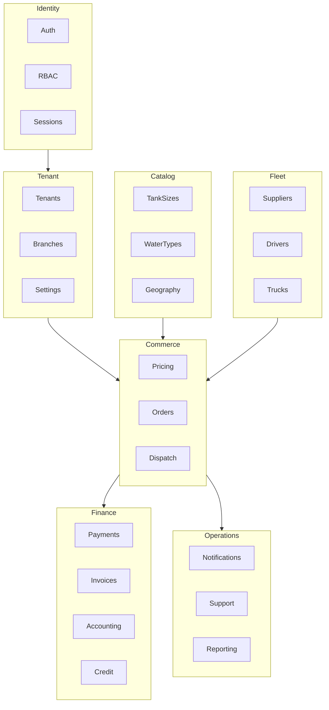
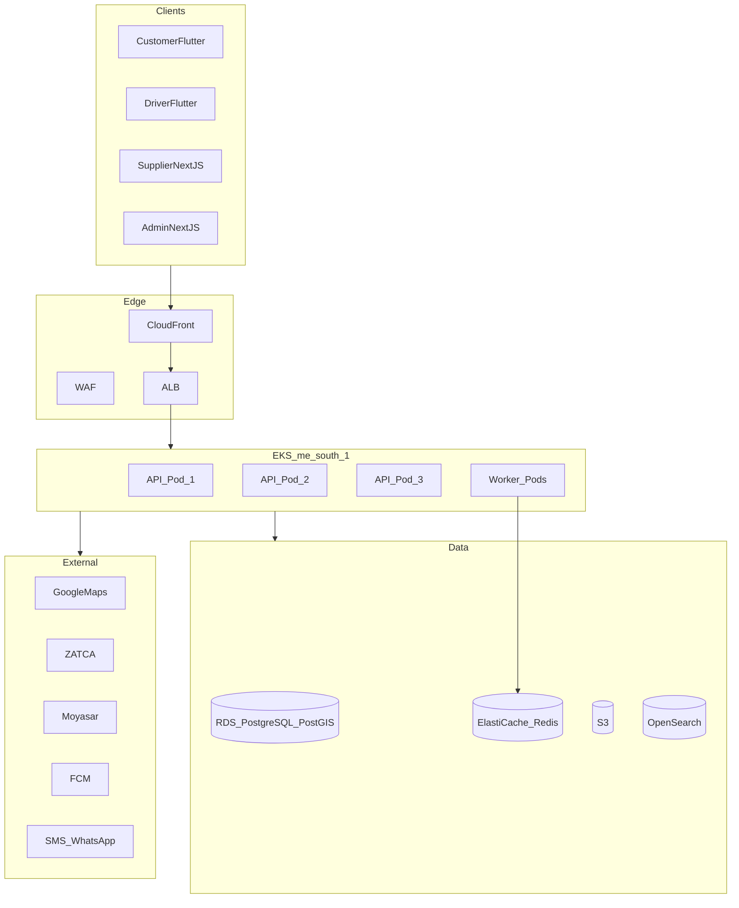

# System Architecture

## Overview

Modular monolith (NestJS) with clear bounded contexts, extract-to-microservice path for Dispatch, Notifications, and Payments at scale.

## Tenant Operating Modes

| Mode | Description | Revenue |
|------|-------------|---------|
| `marketplace` | Platform owns customers; suppliers compete | Commission per order |
| `private` | White-label; supplier owns customers | Monthly SaaS fee |
| `franchise` | Parent manages branches | SaaS + royalty |

## Bounded Contexts

## Deployment Architecture

## Request Flow

1. Client sends request with `Authorization: Bearer <jwt>` and `X-Tenant-Id: <uuid>`
2. API Gateway / ALB terminates TLS
3. NestJS middleware: rate limit → tenant resolve → JWT verify → RBAC guard
4. Controller → Service → Repository (Prisma)
5. Side effects via BullMQ jobs (notifications, invoicing, accounting)

## Real-Time Architecture

- **WebSocket** (Socket.io): live order tracking, dispatch updates, admin live map
- **Redis pub/sub**: broadcast driver location updates to subscribed clients
- **FCM**: push notifications when app backgrounded

## Multi-Tenant Isolation

- Every business table has `tenant_id` column
- Prisma middleware injects `tenant_id` filter on all queries
- PostgreSQL RLS as defense-in-depth
- Tenant resolved from JWT claims or `X-Tenant-Id` header

## Scalability Path

| Phase | Architecture | Trigger |
|-------|-------------|---------|
| Launch | Modular monolith, 3 API pods | < 10k orders/day |
| Growth | Extract dispatch service | > 10k orders/day |
| Scale | Extract payments + notifications | > 50k orders/day |
| Enterprise | Full microservices | Multi-region GCC |

## Security Layers

1. TLS 1.3 (edge)
2. WAF (OWASP rules)
3. Rate limiting (Redis, 100 req/min/user)
4. JWT + refresh rotation
5. RBAC per endpoint
6. Tenant isolation (app + DB)
7. Audit log (immutable)
8. Encryption at rest (RDS, S3)

## Extract-to-Microservice Candidates

| Service | Trigger | Interface |
|---------|---------|-----------|
| Dispatch | High order volume, complex ML | gRPC / REST internal |
| Notifications | Multi-channel fan-out | Queue consumer |
| Payments | PCI isolation | Internal API + webhook |
