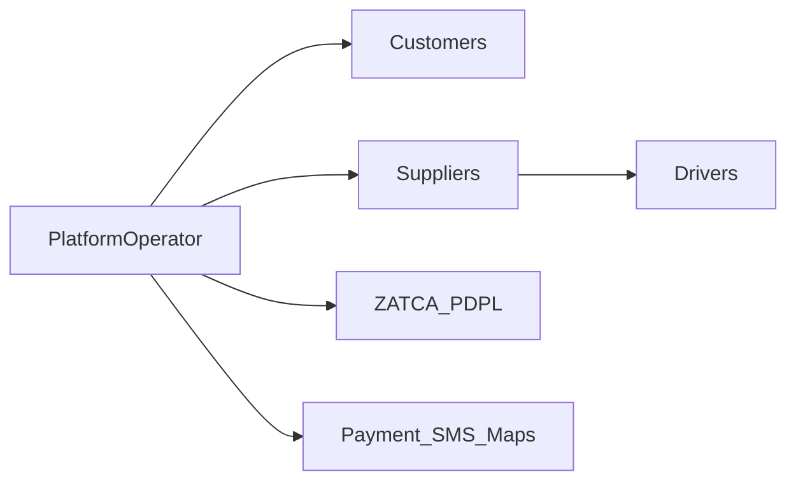

# Business Model Canvas — Water Tanker Platform (سقيا)

## Value Propositions

| Segment | Value |
|---------|-------|
| Customers (B2C/B2B) | 3-tap ordering, live tracking, credit accounts, ZATCA invoices, Arabic-first UX |
| Suppliers | Fleet ERP lite, dispatch automation, settlements, revenue analytics |
| Drivers | Fair earnings, navigation, digital POD, wallet |
| Platform operator | Commission + SaaS revenue, multi-tenant scalability |

## Customer Segments

- Households, factories, construction sites, hotels, restaurants, farms, government offices
- White-label tenants (independent water companies)
- Franchise branch operators

## Channels

- Customer & Driver mobile apps (Flutter)
- Supplier & Admin web portals (Next.js)
- SMS OTP, WhatsApp, push notifications
- Field sales for enterprise B2B onboarding

## Revenue Streams

| Stream | Rate |
|--------|------|
| Marketplace commission | 10% default (5–15% configurable) |
| SaaS subscription | SAR 499–4,999/mo by fleet size |
| Payment processing markup | 0.5–1% |
| Credit facilitation fee | 1–2% |
| Premium add-ons | AI BI, API access |

## Key Resources

- Dispatch engine, payment/ZATCA integration, fleet data, supplier network
- AWS infrastructure (me-south-1), Google Maps, certified EGS

## Key Activities

- Supplier onboarding & KYC, dispatch operations, credit underwriting, ZATCA compliance

## Key Partners

- Payment gateways (Moyasar/HyperPay), SMS (Unifonic/Msegat), ZATCA Fatoora
- Water suppliers, fleet owners, enterprise customers

## Cost Structure

- Engineering team, cloud infra ($5–10k/mo at scale), maps/SMS APIs
- Customer support, compliance, sales

## Stakeholder Map

