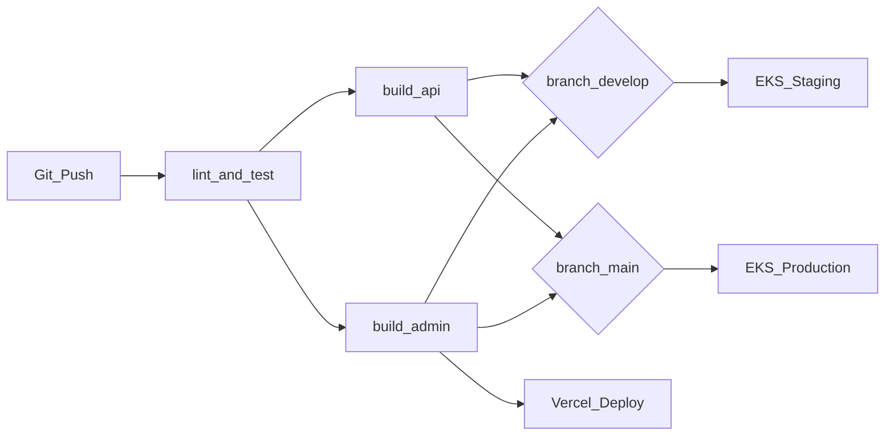

# CI/CD Pipeline

**Phase 14 · Sprint 11** — Continuous integration and deployment for the Suqya monorepo.

## Overview



Pipeline definition: `.github/workflows/ci.yml`

## Triggers

| Event | Branches | Jobs Run |
|-------|----------|----------|
| Push | `main`, `develop` | Full pipeline |
| Pull request | → `main` | `lint-and-test` only (no deploy) |

## Global Environment

```yaml
NODE_VERSION: '20'
```

Matches `package.json` engines (`>=20.0.0`).

## Jobs

### 1. `lint-and-test`

Runs on every push and PR.

| Step | Command | Purpose |
|------|---------|---------|
| Checkout | `actions/checkout@v4` | Source code |
| Node setup | `actions/setup-node@v4` with npm cache | Dependency install |
| Install | `npm ci` | Reproducible install across workspaces |
| Lint | `npm run lint --if-present` | ESLint across all workspaces |
| Test | `npm run test -w @suqya/api` | Jest unit/integration tests |

**Key test files:**
- `apps/api/src/modules/dispatch/dispatch.service.spec.ts`
- `apps/api/src/modules/order/order-state-machine.spec.ts`

### 2. `build-api`

Depends on `lint-and-test`. Validates the NestJS API builds and produces a Docker image.

| Step | Command |
|------|---------|
| Install | `npm ci` |
| Build | `npm run build -w @suqya/api` |
| Docker | `docker build -t suqya/api:${{ github.sha }} -f infra/docker/Dockerfile.api .` |

**Dockerfile stages** (`infra/docker/Dockerfile.api`):
1. **Builder**: `npm ci --workspace=@suqya/api`, compile TypeScript, `prisma generate`
2. **Runtime**: Alpine Node 20, exposes port 4000, `CMD node dist/main.js`

### 3. `build-admin`

Depends on `lint-and-test`. Validates the admin Next.js app compiles.

| Step | Command |
|------|---------|
| Install | `npm ci` |
| Build | `npm run build -w @suqya/admin-web` |

> Supplier web (`@suqya/supplier-web`) should be added to CI in Sprint 12.

### 4. `deploy-staging`

| Condition | `github.ref == 'refs/heads/develop'` |
|-----------|--------------------------------------|
| Environment | `staging` (GitHub environment with protection rules) |
| Target | EKS staging cluster |

**Planned steps** (Sprint 11 scaffold):
1. Configure AWS credentials via OIDC
2. Push image to ECR: `suqya/api:${{ github.sha }}`
3. `kubectl set image` in `suqya-staging` namespace
4. Run `prisma migrate deploy`
5. Smoke test `/v1/tenants/public`

### 5. `deploy-production`

| Condition | `github.ref == 'refs/heads/main'` |
|-----------|-------------------------------------|
| Environment | `production` (requires manual approval) |
| Target | EKS production cluster |

**Planned steps**:
1. Blue-green deployment (see [deployment-guide.md](deployment-guide.md))
2. RDS pre-deploy snapshot
3. Post-deploy smoke tests
4. Slack/PagerDuty notification

## Branch Strategy

| Branch | Purpose | Deploys To |
|--------|---------|------------|
| `main` | Production-ready code | EKS production + Vercel prod |
| `develop` | Integration branch | EKS staging + Vercel preview |
| `feature/*` | Sprint work | PR checks only |
| `hotfix/*` | Production fixes | Fast-track to `main` |

## Vercel Deployment

Web portals deploy separately from the GitHub Actions pipeline via Vercel Git integration or CLI:

```bash
# Admin dashboard
npx vercel link --project admin-web --yes
npx vercel deploy --prod --yes --local-config vercel.admin.json

# Supplier portal
npx vercel link --project supplier-web --yes
npx vercel deploy --prod --yes --local-config vercel.supplier.json
```

Vercel projects watch `apps/admin-web/` and `apps/supplier-web/` respectively.

### Required Vercel environment variables

| Variable | Environments |
|----------|-------------|
| `NEXT_PUBLIC_API_URL` | Production, Preview |
| `NEXT_PUBLIC_TENANT_ID` | Per-tenant white-label builds |

## Secrets Management

| Secret | Storage | Used By |
|--------|---------|---------|
| `AWS_ROLE_ARN` | GitHub Actions secrets | EKS deploy jobs |
| `DB_PASSWORD` | GitHub Actions + AWS Secrets Manager | Terraform, migrations |
| `VERCEL_TOKEN` | GitHub Actions secrets | Optional CLI deploy |
| `MOYASAR_SECRET_KEY` | AWS Secrets Manager | API pods |
| `JWT_SECRET` | AWS Secrets Manager | API pods |
| `ZATCA_API_TOKEN` | AWS Secrets Manager | API pods |

Never commit secrets. `apps/api/.env.example` contains placeholders only.

## Database Migrations in CI/CD

Prisma migrations live in `apps/api/prisma/migrations/`.

**Policy:**
- Migrations are forward-only (no destructive changes without approval)
- Run `prisma migrate deploy` as a Kubernetes Job before switching traffic
- Breaking schema changes require a two-phase deploy (add column → deploy code → remove old column)

```bash
# Local development
npm run db:migrate    # prisma migrate dev

# CI/CD production
npx prisma migrate deploy --schema=apps/api/prisma/schema.prisma
```

## Mobile CI (Planned — Sprint 12)

| Platform | Tool | Trigger |
|----------|------|---------|
| Android | `flutter build apk` + Fastlane | Tag `v*` |
| iOS | `flutter build ipa` + Fastlane | Tag `v*` |

## Quality Gates

| Gate | Threshold | Blocks Deploy |
|------|-----------|---------------|
| Unit test pass rate | 100% | Yes |
| Lint errors | 0 | Yes |
| API build | Success | Yes |
| Admin build | Success | Yes |
| Code coverage (API) | ≥ 80% business logic | Warning only |
| OWASP ZAP scan | No high/critical | Pre-production |
| k6 load test | p99 < 500ms at 1000 VU | Pre-production |

## Rollback Procedure

1. **API**: `kubectl rollout undo deployment/suqya-api -n suqya-production`
2. **Database**: Restore from pre-deploy RDS snapshot (see [disaster-recovery.md](../operations/disaster-recovery.md))
3. **Vercel**: Promote previous deployment in Vercel dashboard
4. **Mobile**: Cannot rollback API breaking changes; maintain backward compatibility

## Monitoring Deployments

Post-deploy checks (automated in future sprint):

```bash
# Verify rollout
kubectl rollout status deployment/suqya-api -n suqya-production

# Check pod health
kubectl get pods -n suqya-production -l app=suqya-api

# API health
curl -sf https://api.suqya.sa/v1/tenants/public
```

## Related Documentation

- [Deployment Guide](deployment-guide.md)
- [Infrastructure](infrastructure.md)
- [Operations Manual](../operations/ops-manual.md)
- [Troubleshooting](../operations/troubleshooting.md)
