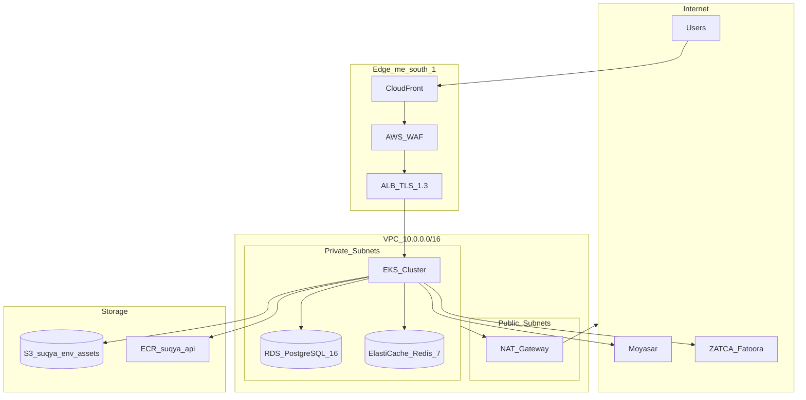

# Infrastructure

**Phase 14 · Sprint 11** — AWS infrastructure for Suqya in `me-south-1` (Bahrain), chosen for PDPL data residency alignment with Saudi operations.

## Repository Layout

```
infra/
  terraform/
    main.tf           # VPC, RDS, ElastiCache, S3
  k8s/
    api-deployment.yaml   # Deployment, Service, HPA
  docker/
    docker-compose.yml    # Local PostGIS + Redis
    Dockerfile.api        # Multi-stage NestJS build
```

## Network Topology



## Terraform Resources

Defined in `infra/terraform/main.tf`:

| Resource | Identifier | Configuration |
|----------|------------|---------------|
| VPC | `aws_vpc.main` | `10.0.0.0/16`, DNS enabled |
| RDS PostgreSQL | `aws_db_instance.postgres` | PG 16, `db.t3.medium`, 100 GB encrypted |
| ElastiCache | `aws_elasticache_cluster.redis` | Redis 7, `cache.t3.micro` |
| S3 | `aws_s3_bucket.assets` | AES-256 SSE, POD photos, invoices, CR docs |

### Environment variables

| Variable | Default | Notes |
|----------|---------|-------|
| `aws_region` | `me-south-1` | Saudi/GCC latency |
| `environment` | `staging` | Override for production |
| `project_name` | `suqya` | Resource naming prefix |
| `db_password` | (required) | Sensitive, via TF_VAR or CI secret |

### Production overrides

| Setting | Staging | Production |
|---------|---------|------------|
| `multi_az` | `false` | `true` |
| `skip_final_snapshot` | `true` | `false` |
| `backup_retention_period` | 7 days | 35 days |
| RDS instance class | `db.t3.medium` | `db.r6g.large` |
| Redis nodes | 1 | 2 (cluster mode) |

### Terraform commands

```bash
cd infra/terraform
terraform init
terraform plan -var="environment=staging" -var="db_password=$DB_PASSWORD"
terraform apply -var="environment=staging" -var="db_password=$DB_PASSWORD"
```

Outputs: `db_endpoint`, `redis_endpoint`, `s3_bucket`.

## EKS Cluster

### Node configuration

| Setting | Value |
|---------|-------|
| Kubernetes version | 1.29+ |
| Node group | `t3.large` × 3 (staging), `t3.xlarge` × 5 (production) |
| Namespaces | `suqya-staging`, `suqya-production` |
| Ingress | AWS Load Balancer Controller → ALB |

### API workload

From `infra/k8s/api-deployment.yaml`:

| Setting | Value |
|---------|-------|
| Replicas | 3 (HPA: 3–10) |
| Container port | 4000 |
| CPU request/limit | 250m / 1000m |
| Memory request/limit | 512Mi / 1Gi |
| Liveness probe | `GET /v1/tenants/public` |
| Readiness probe | `GET /v1/tenants/public` |
| Secrets | `suqya-secrets` (database-url, redis-host, jwt-secret) |

### Worker pods

BullMQ processors run in the same deployment image with `WORKER_MODE=true`:

| Queue | Processor | Module |
|-------|-----------|--------|
| `dispatch` | `DispatchProcessor` | `apps/api/src/modules/dispatch/` |
| `notification` | `NotificationProcessor` | `apps/api/src/modules/notification/` |

Scale workers independently by deploying a separate `suqya-worker` deployment with higher replica count.

## Data Layer

### PostgreSQL + PostGIS

- **Engine**: PostgreSQL 16 with PostGIS 3.4 (local via `postgis/postgis:16-3.4`)
- **Schema**: Managed by Prisma (`apps/api/prisma/schema.prisma`)
- **Extensions**: `postgis` (delivery zones, driver locations), `uuid-ossp`
- **RLS**: Row-level security on tenant-scoped tables as defense-in-depth
- **Connection pooling**: PgBouncer sidecar or RDS Proxy in production

Key domain tables: `Tenant`, `Order`, `Driver`, `Supplier`, `Invoice`, `Transaction`, `Wallet`, `CreditAccount`.

### Redis

| Use Case | Key Pattern |
|----------|-------------|
| BullMQ job queues | `bull:dispatch:*`, `bull:notification:*` |
| Rate limiting | `ratelimit:{userId}` |
| Session cache | `session:{sessionId}` |
| WebSocket pub/sub | `ws:tenant:{tenantId}:orders` |
| OTP throttling | `otp:{phone}:attempts` |

### S3

| Prefix | Content | Retention |
|--------|---------|-----------|
| `pod/{orderId}/` | Proof-of-delivery photos | 7 years |
| `invoices/{tenantId}/` | PDF/A-3 tax invoices | 7 years |
| `documents/{supplierId}/` | CR, VAT, water quality certs | Life of account + 2 years |
| `exports/{tenantId}/` | PDPL data exports | 30 days |

## External Integrations

| Service | Purpose | Config Location |
|---------|---------|-----------------|
| Moyasar | Card payments (SAR) | `MOYASAR_*` env vars |
| ZATCA Fatoora | E-invoicing Phase 1 & 2 | `ZATCA_*` env vars |
| Google Maps | Geocoding, routing | `GOOGLE_MAPS_API_KEY` |
| FCM | Push notifications | `FCM_SERVER_KEY` |
| Unifonic / Twilio | SMS OTP, WhatsApp | `SMS_*` env vars |

## Vercel (Web Frontends)

Admin and supplier portals are **not** on EKS. They deploy to Vercel:

| App | Config File | Project |
|-----|-------------|---------|
| Admin | `vercel.admin.json` | `admin-web` |
| Supplier | `vercel.supplier.json` | `supplier-web` |

Vercel edge network serves static assets; API calls proxy to EKS ALB via `NEXT_PUBLIC_API_URL`.

## Monitoring & Observability

| Tool | Scope |
|------|-------|
| CloudWatch | EKS logs, RDS metrics, ALB access logs |
| Datadog / Grafana | APM, custom dashboards (order funnel, dispatch latency) |
| AWS WAF | OWASP rule set, geo-blocking |
| Prisma query logging | Slow query alerts (> 200ms) |

### Key alerts

- API p99 latency > 500ms for 5 minutes
- RDS CPU > 80% or storage < 20% free
- Redis memory > 85%
- EKS pod restart count > 3 in 10 minutes
- ZATCA submission failure rate > 1%
- Moyasar webhook processing lag > 60 seconds

## Cost Estimates (Production)

| Resource | Monthly (USD) |
|----------|---------------|
| EKS control plane | ~$73 |
| EC2 nodes (5× t3.xlarge) | ~$600 |
| RDS Multi-AZ (r6g.large) | ~$400 |
| ElastiCache (2 nodes) | ~$100 |
| S3 + CloudFront | ~$50 |
| NAT Gateway | ~$100 |
| **Total** | **~$1,300** |

Staging runs at ~30% of production cost with smaller instance classes and single-AZ RDS.

## Security Hardening

- All data encrypted at rest (RDS, S3, EBS)
- TLS 1.3 termination at ALB
- Private subnets for RDS, Redis, EKS worker nodes
- Security groups: API pods → RDS:5432, Redis:6379 only
- IAM roles for service accounts (IRSA) for S3 access
- No public RDS endpoints
- Secrets in AWS Secrets Manager, not in manifests

## Related Documentation

- [Deployment Guide](deployment-guide.md)
- [CI/CD](cicd.md)
- [Security Policy](../security/security-policy.md)
- [ADR: AWS EKS](../adr/002-aws-eks.md)
