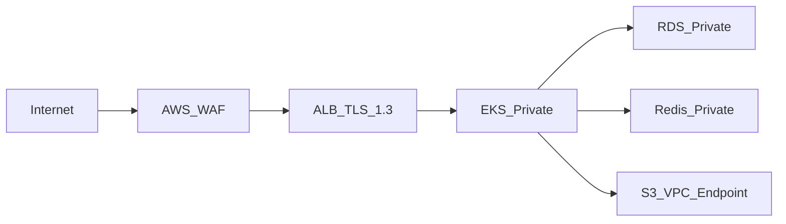

# Security Policy

**Phase 14 · Sprint 11** — Information security policy for the Suqya water tanker platform.

## Scope

This policy applies to all Suqya platform components:

- NestJS API (`apps/api`)
- Admin dashboard (`apps/admin-web`)
- Supplier portal (`apps/supplier-web`)
- Customer app (`apps/customer-app`)
- Driver app (`apps/driver-app`)
- AWS infrastructure (`infra/`)
- Third-party integrations (Moyasar, ZATCA, Google Maps, FCM, SMS)

## Compliance Framework

| Regulation | Applicability | Implementation |
|------------|---------------|----------------|
| PDPL (Saudi Personal Data Protection Law) | All PII processing | `PdplService` in `modules/security/` |
| ZATCA E-Invoicing | Tax invoices | `ZatcaService` in `modules/invoice/` |
| PCI DSS (SAQ A) | Card payments via Moyasar | No card data stored; redirect to Moyasar hosted page |
| Saudi VAT Law | 15% VAT on taxable supplies | Pricing engine, invoice generation |
| NCA Cybersecurity Controls | Platform security | This policy |

## Data Classification

| Class | Examples | Storage | Encryption |
|-------|----------|---------|------------|
| **Public** | Tank sizes, water types, public pricing | API response | TLS in transit |
| **Internal** | Order metrics, dispatch rules | PostgreSQL | AES-256 at rest (RDS) |
| **Confidential** | Customer PII, phone numbers, addresses | PostgreSQL + RLS | AES-256 at rest + tenant isolation |
| **Restricted** | Payment tokens, JWT secrets, ZATCA certs | AWS Secrets Manager | KMS encryption |
| **Regulated** | Tax invoices, audit logs, CR documents | PostgreSQL + S3 | 7-year retention, immutable audit |

## Authentication & Authorization

### Authentication methods

| Actor | Method | Module |
|-------|--------|--------|
| Customer | Phone OTP | `modules/auth/` |
| Driver | Phone OTP | `modules/auth/` |
| Supplier | Email + password + optional 2FA | `modules/auth/`, `modules/security/` |
| Admin | Email + password + mandatory 2FA | `modules/auth/`, `TwoFactorService` |

### JWT token policy

| Setting | Value |
|---------|-------|
| Access token TTL | 15 minutes |
| Refresh token TTL | 7 days |
| Refresh rotation | Single-use; old token invalidated on refresh |
| Algorithm | HS256 (production: RS256 planned) |
| Claims | `sub`, `tenantId`, `roles`, `iat`, `exp` |

### RBAC model

Defined in Prisma schema: `Role`, `Permission`, `RolePermission`, `UserRoleAssignment`.

| Role | Scope | Key Permissions |
|------|-------|----------------|
| `super_admin` | Platform-wide | All tenants, system config |
| `tenant_admin` | Single tenant | Tenant settings, users, reports |
| `supplier_manager` | Supplier entity | Fleet, orders, settlements |
| `driver` | Assigned orders | Accept jobs, POD, earnings |
| `customer` | Own data | Orders, wallet, invoices |
| `support_agent` | Tenant orders | View orders, create tickets |
| `finance` | Tenant financials | Settlements, credit, accounting |

Guards applied at controller level via NestJS `@Roles()` decorator and `RbacGuard`.

## Multi-Tenant Isolation

Defense-in-depth approach:

1. **Application layer**: Prisma middleware injects `tenantId` filter on all queries
2. **Database layer**: PostgreSQL Row-Level Security (RLS) policies on tenant-scoped tables
3. **Request layer**: `X-Tenant-Id` header validated against JWT `tenantId` claim
4. **Network layer**: Single API deployment; isolation is logical, not physical

Every business table includes `tenant_id` column (see `apps/api/prisma/schema.prisma`).

## Encryption

| Layer | Method |
|-------|--------|
| In transit | TLS 1.3 (ALB, CloudFront) |
| At rest — RDS | AWS-managed AES-256 |
| At rest — S3 | SSE-S3 (AES-256) |
| At rest — EBS | AWS-managed encryption |
| At rest — Redis | Encryption in transit (TLS); at-rest for ElastiCache in production |
| Secrets | AWS Secrets Manager with KMS |
| Passwords | bcrypt (cost factor 12) |
| OTP codes | Hashed before storage; 5-minute TTL |

## Network Security

- **WAF rules**: OWASP Core Rule Set, geo-blocking (allow SA/GCC + admin VPN)
- **Security groups**: Least-privilege; API pods only reach RDS:5432, Redis:6379, S3
- **No public endpoints** for database or cache
- **VPC flow logs** enabled for anomaly detection

## Rate Limiting

Redis-backed rate limiter in API middleware:

| Endpoint Category | Limit |
|-------------------|-------|
| General API | 100 req/min/user |
| OTP request | 3 req/10 min/phone |
| Login attempts | 5 req/15 min/IP |
| Payment creation | 10 req/min/user |
| File upload | 5 req/min/user |

## Audit Logging

Immutable audit trail via `AuditService` (`modules/security/security.service.ts`):

| Field | Description |
|-------|-------------|
| `tenantId` | Tenant scope |
| `userId` | Acting user |
| `action` | e.g., `order.cancel`, `payment.refund`, `user.role_change` |
| `entityType` | e.g., `Order`, `Transaction`, `User` |
| `entityId` | Affected record ID |
| `metadata` | JSON context (before/after values) |
| `createdAt` | Timestamp (immutable) |

Audit logs are append-only. No UPDATE or DELETE operations permitted.

## PDPL Compliance

Implemented in `PdplService`:

| Right | Implementation |
|-------|----------------|
| Right to access | `GET /v1/security/data-export` — JSON export of all user data |
| Right to deletion | `POST /v1/security/data-deletion-request` — 30-day processing |
| Consent management | Onboarding consent + granular notification preferences |
| Data minimization | Collect only required fields per role |
| Purpose limitation | Privacy policy per data category |
| Breach notification | 72-hour SDAIA notification process |
| Data residency | Primary storage in `me-south-1` (AWS Bahrain) |
| Processor agreements | DPA with Moyasar, Google, AWS, Unifonic |

## Payment Security

- **No card data stored** on Suqya servers (PCI SAQ A)
- Moyasar hosted payment page handles card entry
- Webhook verification via HMAC signature (`payment.service.ts`)
- Transaction amounts validated server-side (never trust client amount)
- Refunds require admin authorization + audit log entry

## ZATCA Security

- EGS cryptographic stamp stored in AWS Secrets Manager
- Invoice UUIDs generated server-side (UUIDv4), immutable
- UBL 2.1 XML signed with certified private key
- QR code TLV encoding per ZATCA specification
- Submission responses stored in `InvoiceZatcaSubmission` for audit

## Vulnerability Management

| Activity | Frequency |
|----------|-----------|
| `npm audit` in CI | Every push |
| OWASP ZAP scan | Pre-production release |
| Dependency updates | Weekly Dependabot PRs |
| Penetration test | Annually (external firm) |
| Security code review | Every PR to `main` |

## Incident Response

### Severity classification

| Level | Criteria | Response Time |
|-------|----------|---------------|
| SEV-1 | Active breach, data exfiltration, full outage | 15 minutes |
| SEV-2 | Suspected breach, partial outage, payment failure | 30 minutes |
| SEV-3 | Vulnerability discovered, non-critical outage | 4 hours |
| SEV-4 | Security improvement, low-risk finding | Next sprint |

### Response steps

1. **Detect** — Monitoring alerts, user reports, audit log anomalies
2. **Contain** — Revoke credentials, isolate systems, block IPs
3. **Investigate** — Determine scope, timeline, affected data
4. **Eradicate** — Patch vulnerability, rotate secrets
5. **Recover** — Restore services, verify integrity
6. **Notify** — SDAIA (72h for PDPL), affected users, Moyasar if payment-related
7. **Review** — Post-incident report, update this policy

### Secret rotation schedule

| Secret | Rotation | Method |
|--------|----------|--------|
| `JWT_SECRET` | Quarterly | Blue-green deploy with dual validation window |
| `MOYASAR_SECRET_KEY` | On compromise | Moyasar dashboard + K8s secret update |
| `ZATCA_API_TOKEN` | Annually | ZATCA portal |
| `DB_PASSWORD` | Quarterly | RDS modify + rolling pod restart |
| Admin 2FA seeds | On personnel change | `TwoFactorService.generateSecret()` |

## Secure Development Practices

- Input validation via NestJS `ValidationPipe` (whitelist + forbidNonWhitelisted)
- Helmet.js for HTTP security headers
- Parameterized queries via Prisma (no raw SQL injection)
- CORS restricted to known origins (`CORS_ORIGINS` env var)
- No secrets in source code or Docker images
- `.env` files in `.gitignore`; `.env.example` has placeholders only
- Feature flags for gradual security feature rollout

## Third-Party Risk

| Vendor | Data Shared | DPA Status | Assessment |
|--------|-------------|------------|------------|
| AWS | All platform data | Signed | SOC 2 Type II |
| Moyasar | Payment metadata | Signed | PCI DSS Level 1 |
| Google Maps | Addresses, coordinates | Signed | SOC 2 |
| Firebase (FCM) | Device tokens | Signed | SOC 2 |
| Unifonic | Phone numbers | Signed | ISO 27001 |
| Vercel | Static web assets only | Signed | SOC 2 Type II |
| ZATCA | Invoice data | Government API | NCA certified |

## Access Control

| System | Access Method | Review Frequency |
|--------|--------------|------------------|
| AWS Console | SSO + MFA | Monthly |
| EKS (`kubectl`) | IAM role + MFA | Monthly |
| GitHub | SSO + MFA + branch protection | Monthly |
| Vercel | Team invite + MFA | Quarterly |
| Moyasar Dashboard | Role-based + MFA | Quarterly |
| ZATCA Portal | Certificate-based | Annually |
| Admin Dashboard | RBAC + 2FA | Per hire/termination |

## Related Documentation

- [Compliance Matrix](../business/compliance-matrix.md)
- [Disaster Recovery](../operations/disaster-recovery.md)
- [ADR: Payment Gateway](../adr/003-payment-gateway.md)
- [Troubleshooting](../operations/troubleshooting.md)
