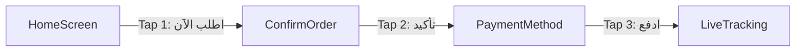
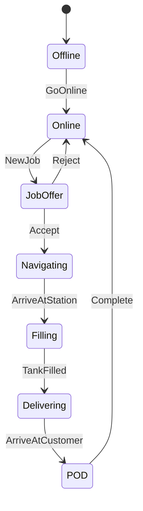
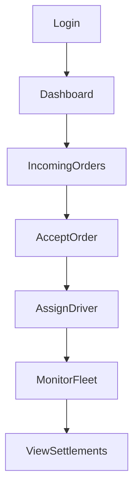
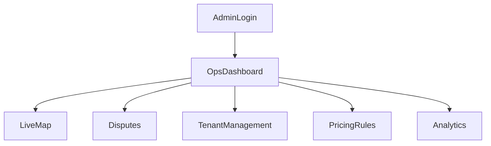

# User Journeys & Flows

## Customer — 3-Tap Order Flow



### Detailed Steps

1. **Home** — Pre-filled address from last order or default; last tank size shown; price estimate visible
2. **Confirm** — Tank size selector (if changed), delivery instructions, schedule option
3. **Payment** — Cash / Card / Credit (if approved); tap confirm
4. **Tracking** — Live map, ETA, driver info, status updates

### Customer Journey Map

| Stage | Touchpoints | Emotion | Pain Points Solved |
|-------|-------------|---------|-------------------|
| Discover | App store, referral, supplier QR | Curious | No unified platform |
| Register | OTP, profile, address | Easy | No password needed |
| Order | 3-tap flow | Delighted | Phone/WhatsApp hassle |
| Track | Live map, notifications | Reassured | Unknown ETA |
| Receive | POD, signature, OTP | Satisfied | Disputes |
| Pay | Card/cash/credit | Convenient | No invoice |
| Repeat | Reorder, favorites | Loyal | Re-entering details |

### Customer Screens Flow

```
Splash → Onboarding(×3) → Login → OTP → Home
Home → NewOrder → TankSelect → PaymentSelect → Tracking
Home → History → OrderDetail → Rate
Home → Invoices → InvoicePDF
Home → Wallet → CreditStatement
Profile → Addresses → AddAddress → MapPicker
Profile → Settings → Language(AR/EN)
```

---

## Driver Journey



### Driver Steps

1. **Login** — OTP, view assigned supplier
2. **Go Online** — Toggle availability, GPS starts
3. **Job Offer** — 30s countdown, order details, earnings estimate
4. **Accept** — Navigate to filling station
5. **Filling** — Mark tank filled, photo optional
6. **Deliver** — Navigate to customer, live tracking shared
7. **POD** — Photo, customer signature, OTP verification
8. **Payment** — Collect cash or confirm card payment
9. **Complete** — Earnings updated, next job

### Offline Support

- Queue POD uploads when connectivity returns
- Cache active job details locally
- Background location when online

---

## Supplier Journey



### Supplier Daily Flow

1. **Morning** — Check dashboard KPIs (pending orders, revenue, fleet status)
2. **Orders** — Accept/reject incoming orders; counter-offer for enterprise
3. **Dispatch** — Auto-assign or manual driver selection
4. **Monitor** — Live map of active deliveries
5. **End of day** — Review completed deliveries, settlements, credit customers
6. **Weekly** — Reports, driver performance, maintenance alerts

---

## Admin Journey



### Admin Operations Flow

1. **Real-time ops** — Live map of all active deliveries across tenants
2. **Intervene** — Manual dispatch override, dispute resolution
3. **Configure** — Cities, zones, tank sizes, pricing rules, commissions
4. **Onboard** — Verify supplier CR/VAT, approve credit customers
5. **Report** — Revenue, orders, heatmaps, export to Excel/PDF
6. **Audit** — Review audit logs, permission changes

---

## Order Lifecycle (System)

| Status | Actor | Next Actions |
|--------|-------|--------------|
| `pending` | System | Broadcast to suppliers |
| `supplier_review` | Supplier | Accept / reject / counter |
| `dispatching` | System | Find nearest driver |
| `driver_offered` | Driver | Accept / reject (30s) |
| `accepted` | Driver | Navigate to fill |
| `filling` | Driver | Mark filled |
| `in_transit` | Driver | Navigate to customer |
| `delivered` | Driver | Submit POD |
| `payment_pending` | System | Capture payment |
| `completed` | System | Invoice + accounting |
| `cancelled` | Customer/Admin | Refund if applicable |
| `disputed` | Any | Admin resolution |

---

## Credit Customer Journey

1. Apply for credit (company docs, CR, requested limit)
2. Supplier or platform approves with limit
3. Order on credit — balance increases
4. Receive invoice with due date
5. Partial or full payment via app/bank transfer
6. Monthly statement with aging (current, 30, 60, 90 days)
7. Reminders at 7d, 3d, 1d before due; overdue alerts
